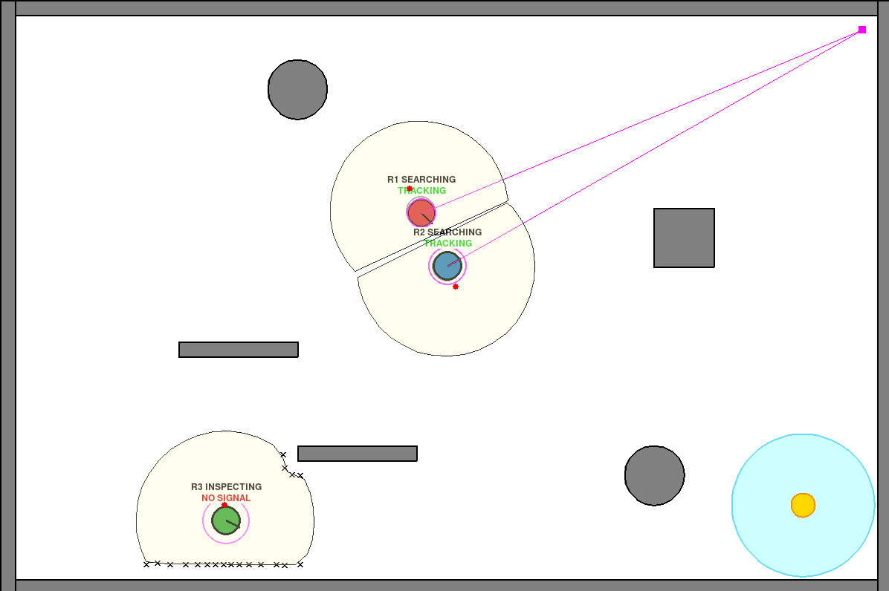
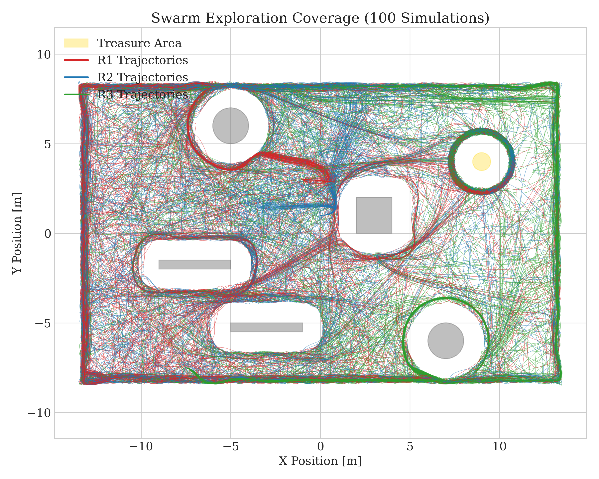
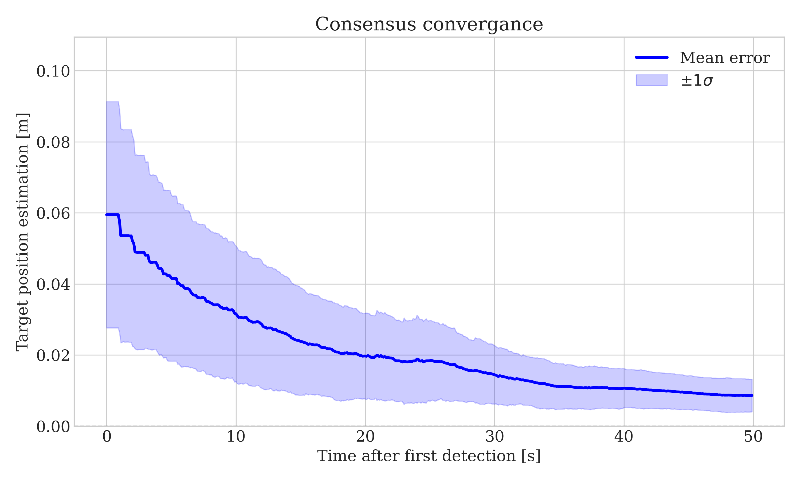
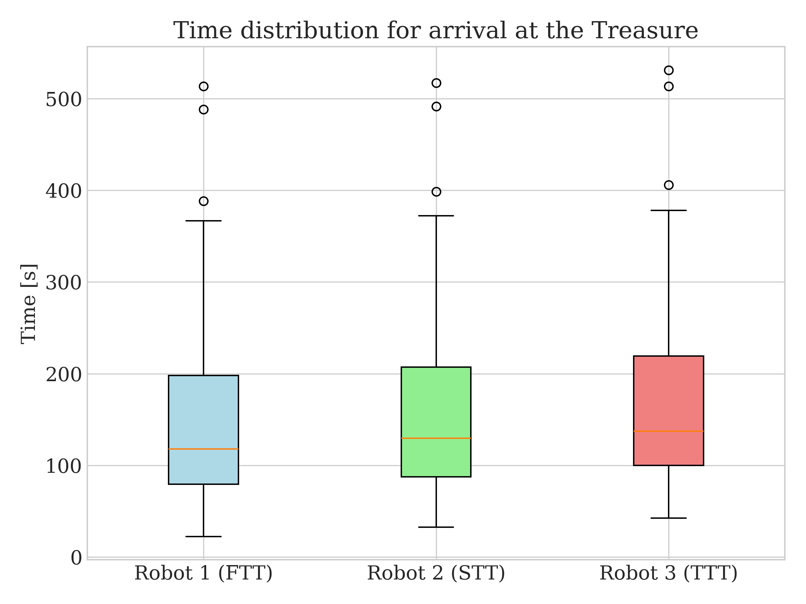
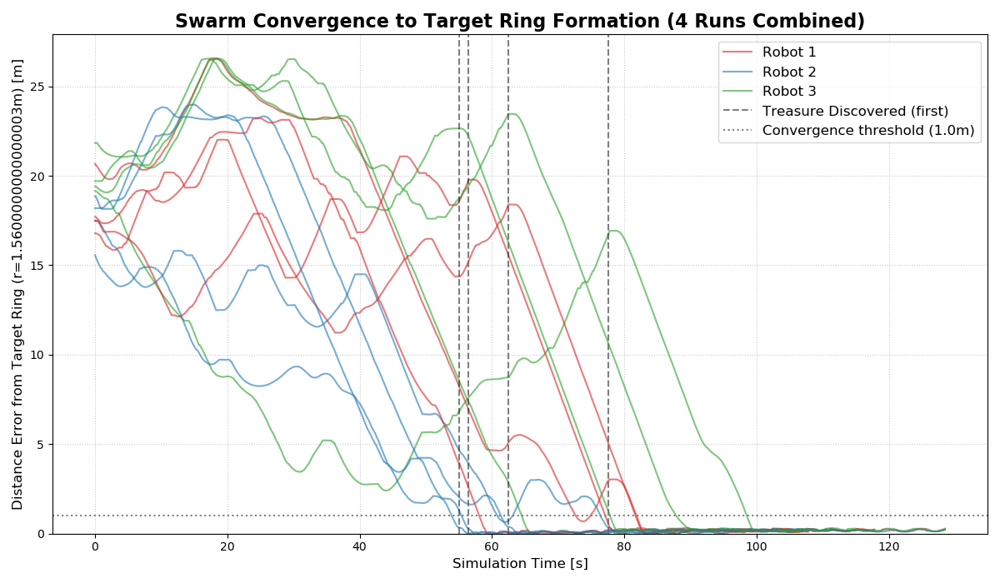
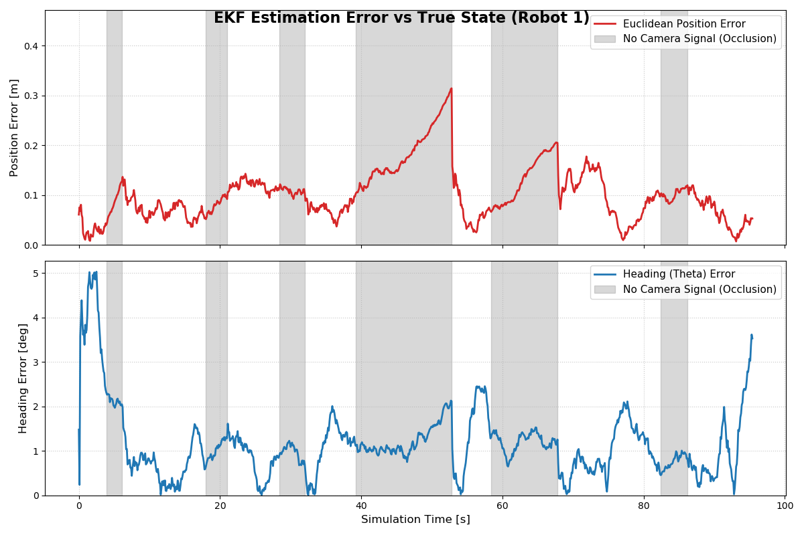

# Swarm Intelligence and Target Search

A Python simulation of a swarm of mobile robots that **explores an unknown 2D environment, finds a hidden target ("treasure") and arranges itself in a ring around it**. Everything is decentralized: each robot plans its own motion and shares information with the others only by broadcasting messages.

The project combines:

- **Lévy-flight exploration**, a random search strategy inspired by how marine predators forage
- **Voronoi–Lloyd partitioning**, to split space between robots, avoid collisions and control the final formation
- an **Extended Kalman Filter (EKF)**, which fuses dead reckoning with an external camera that can be occluded by obstacles
- **LiDAR ray casting**, to detect obstacles and build a shared map
- a **broadcast-gossip consensus**, to refine the swarm's estimate of where the target is
- a **Finite State Machine**, which switches each robot between searching, inspecting and converging on the target

> Project for the *Intelligent Distributed Systems* course, University of Trento.
> Authors: **Alessandro Rossi**, **Lorenzo Franco**.
> 📄 Full report: [`Report/Report.pdf`](Report/Report.pdf)

<p align="center">
  
</p>

---

## Demo

<!-- VIDEO PLACEHOLDER: replace with the run recordings -->
*Simulation videos coming soon.*

---

## How it works

### Scenario

The room is 30 × 20 m and contains static obstacles of several shapes. The target is a point that emits a weak radio signal: a robot detects it only once it is inside the signal's range (blue area), and the signal is blocked by obstacles. A fixed camera in the top-right corner (purple square) measures the robots' poses, but only when it has a clear line of sight to them.

### Robot behavior (FSM)

| State | What the robot does |
|---|---|
| **Searching** | Explores with Lévy flight: picks a random heading and keeps it for a time drawn from a Lévy distribution. Obstacles and other robots are avoided with a bounded repulsive field computed on its Voronoi cell. |
| **Inspecting** | When it meets an obstacle, the robot follows its border, maps it with the LiDAR and checks whether the radio signal is there. |
| **Target found** | The discovery is broadcast to the swarm. Every robot heads to the estimated target and settles on a ring around it with a modified Lloyd algorithm. Consensus keeps refining the target estimate. |

### Localization and communication

- **EKF**: fuses the unicycle model (with noisy commands) with camera measurements. During occlusions the filter runs on prediction only, and the drift is corrected as soon as the camera sees the robot again.
- **Shared map**: robots broadcast the obstacle points they map, building a common map of the environment.
- **Consensus**: two layers. Each robot first filters its own LiDAR measurements of the target over time, then the estimates are merged across the swarm with broadcast gossip.

The math behind each component is in the [report](Report/Report.pdf).

---

## Results

Statistical analysis over **100 independent simulations** with 3 robots, each lasting up to 600 s of simulated time and run in parallel.

| Map coverage | Target estimation error |
|:---:|:---:|
|  |  |
| **Arrival times at the target** | **Formation convergence** |
|  |  |

Main findings:

- Lévy flight covers the map fairly evenly. The areas visited least are the corner farthest from the starting positions and the area around the target.
- The error on the target estimate drops quickly after the first detection and approaches zero as more robots arrive and contribute their measurements.
- Once the target is found, the other robots reach it consistently (narrow spread in the arrival times of the 2nd and 3rd robot) and the ring formation converges in every run.
- The EKF error grows during camera occlusions and is corrected as soon as the camera sees the robot again.
- **Scalability**: with more robots the time to the first detection gets shorter and discoveries are spread more evenly across the robots. Results for 1, 3 and 5 robots are in [`results/figures/`](results/figures/).

<p align="center">
  
</p>

---

## Repository structure

```
.
├── src/                          # Simulation source code
│   ├── config.py                 # Global parameters (environment, robots, noise, EKF…)
│   ├── environment_class.py      # Room, obstacles, target and pygame rendering
│   ├── robot_class.py            # Robot: state, LiDAR, FSM, shared map
│   ├── motion_and_mapping.py     # Controllers: Lévy flight, avoidance, wall following, Lloyd formation, mapping
│   ├── voronoi_cells.py          # Voronoi cell computation
│   ├── ekf_localization.py       # EKF and global camera with occlusions
│   ├── broadcast_and_consensus.py# Message exchange and consensus
│   │
│   ├── main_test.py              # ▶ Interactive simulation (pygame)
│   ├── statistic_test.py         # ▶ Parallel batch of N simulations (headless) → results/data/*.pkl
│   ├── plot_results.py           # ▶ Plots from the batch data → results/figures/
│   ├── plot_formation_converg.py # ▶ Ring formation convergence analysis
│   ├── ekf_test_error.py         # ▶ EKF error analysis with occlusions
│   └── plot_distrib.py           #   Plot of the Lévy distribution
│
├── results/
│   ├── figures/                  # Plots for 1, 3 and 5 robots
│   └── data/                     # Raw .pkl files (not versioned: too large)
│
├── Report/                       # Final report (PDF) and LaTeX sources
├── references/                   # Reference papers
└── requirements.txt
```

---

## Installation

Requires **Python 3.10+**.

```bash
git clone https://github.com/AleRossiS/Intelligent_distributed_systems_PROJECT.git
cd Intelligent_distributed_systems_PROJECT
python -m venv venv
source venv/bin/activate        # Windows: venv\Scripts\activate
pip install -r requirements.txt
```

> The project uses [`pygame-ce`](https://pyga.me/), a drop-in replacement for `pygame` (still imported as `import pygame`) that ships prebuilt wheels for recent Python versions.

## Usage

The scripts can be launched from the repository root.

**Interactive simulation**: opens a pygame window with the swarm in action:

```bash
python src/main_test.py
```

**Statistical analysis**: runs `NUM_RUNS` headless simulations in parallel on every core but one, then plots the results:

```bash
python src/statistic_test.py     # set SWARM_SIZE and NUM_RUNS at the top of the file
python src/plot_results.py       # set FILENAME to the .pkl you generated
```

**Specific analyses**:

```bash
python src/plot_formation_converg.py   # ring formation error over several runs
python src/ekf_test_error.py           # EKF error and camera occlusion periods
```

Simulation parameters (sensing range, number of robots, noise, ray-casting resolution…) are in [`src/config.py`](src/config.py). Obstacles and the target position are defined at the top of each script.

---

## References

- Lévy flight: *Multi-Robot Searching Algorithm Using Lévy Flight and Artificial Potential Field*; *Scaling laws of marine predator search behaviour*
- Voronoi/Lloyd: Cortés et al., *Coverage control for mobile sensing networks*; Fontanelli et al., *Lloyd-based Approach for Robots Navigation in Human-shared Environments*
- Consensus: *Broadcast gossip algorithms*; *A scheme for robust distributed sensor fusion based on average consensus*
- Ray casting: *A Raycast Approach to Collision Avoidance in Sailing Robots*

The PDFs are in [`references/`](references/); the full bibliography is in the report.
